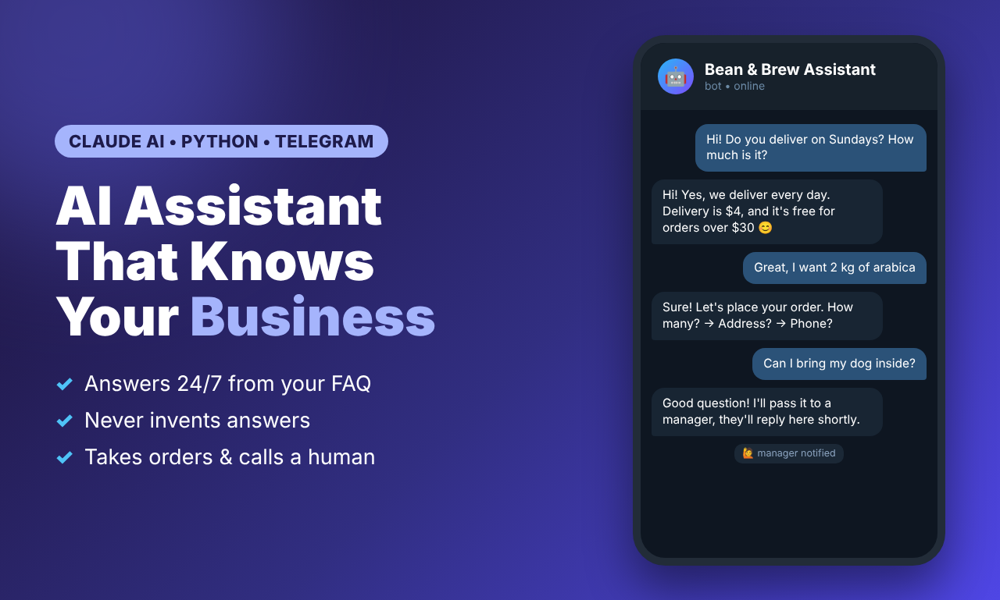
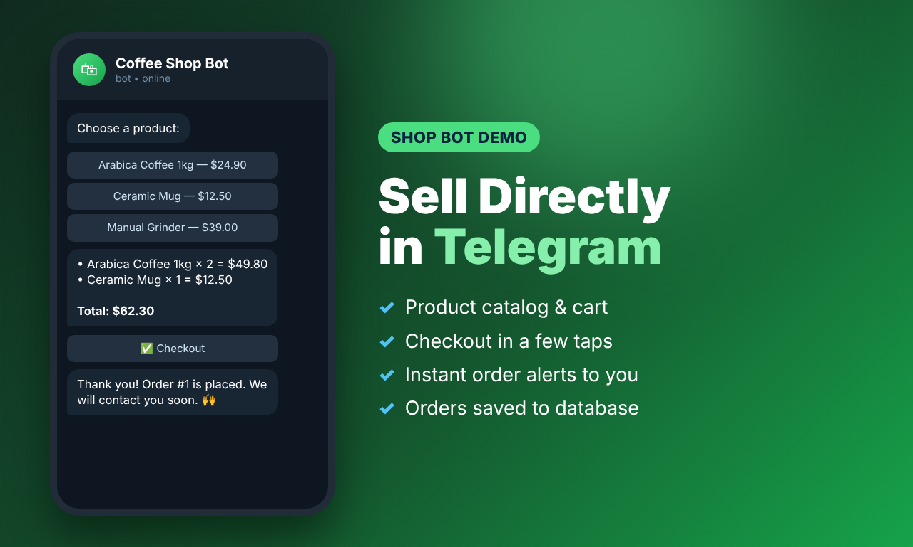
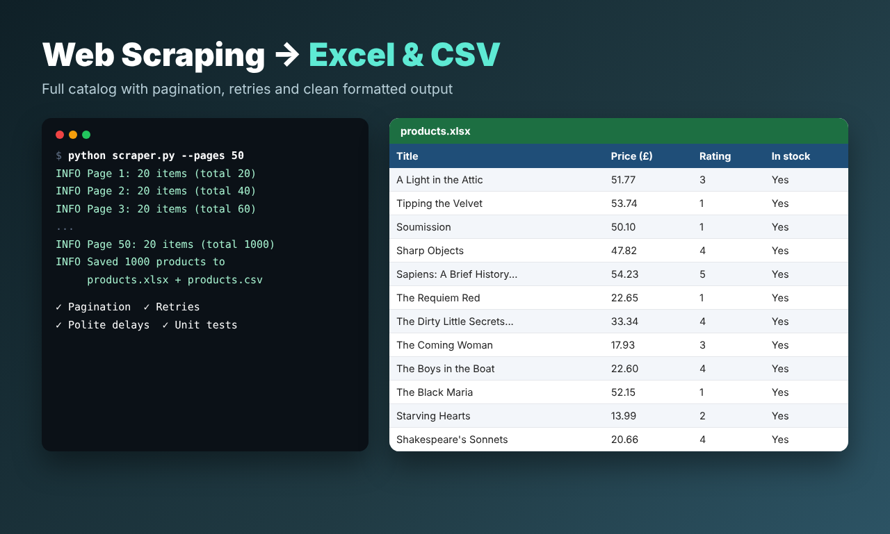
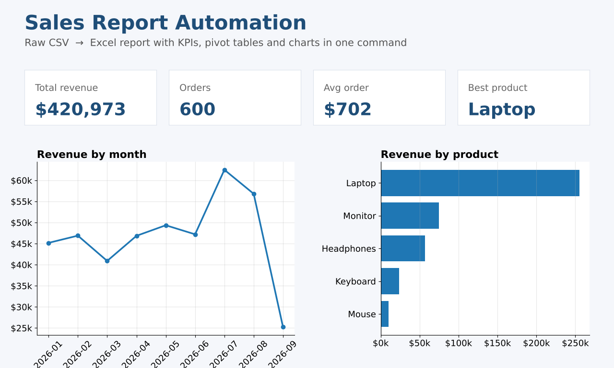

# Python Automation Portfolio

Sample projects showing the kind of work I deliver: Telegram and AI bots, web scraping and business automation.
Each folder has its own README with setup instructions.

| Project | What it does | Stack |
|---|---|---|
| [ai-faq-bot](ai-faq-bot) | AI assistant that answers customers 24/7 from a FAQ, takes orders and hands off to a human | Python, aiogram 3, Claude API |
| [telegram-shop-bot](telegram-shop-bot) | Shop bot with catalog, cart, checkout and admin order notifications | Python, aiogram 3, SQLite |
| [web-scraper-to-excel](web-scraper-to-excel) | Scrapes a full product catalog with pagination into formatted Excel and CSV | requests, BeautifulSoup, openpyxl |
| [sales-report-automation](sales-report-automation) | Turns a raw sales CSV into an Excel report with KPIs, pivots and charts | pandas, openpyxl |

## Previews

**AI FAQ Assistant (Telegram)**

**Telegram Shop Bot**

**Web Scraper → Excel / CSV**

**Sales Report Automation**

Need something similar for your business? Message me on Fiverr.
